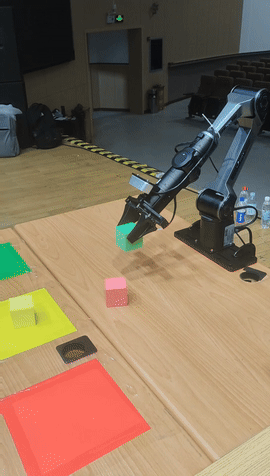
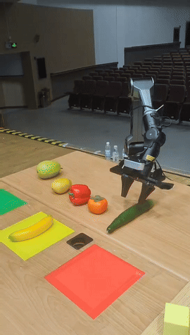

# PiPER 机械夹爪分拣仿真实践

面向分拣比赛的机器人仿真实践，基于已有 PiPER Interactive Demo，使用 **MuJoCo、RGB-D 几何感知、IK 抓放技能与本地中文任务解析**。

覆盖三类任务：颜色方块分拣、固定规则果蔬分拣、中文指令分拣。本人参与仿真开发实践，并与队友共同完成 Linux Spark 平台上的机械臂连接、部署和实机调试。**本仓库保存的是本地仿真版本；不包含 Spark 端完整部署程序。**

## 演示

以下是比赛期间的**实机记录**，与本仓库的 MuJoCo 仿真分开展示。两段完整视频均经过压缩转码，保持原播放速度和完整时长，未剪去中间过程；GIF 仅为 12 秒片段预览。

| L1 方块分拣实机记录 | L2 果蔬分拣实机记录 |
| --- | --- |
| [](media/l1_real.mp4) | [](media/l2_real.mp4) |
| [打开或下载完整 L1 视频](media/l1_real.mp4)，约 2 分 31 秒 | [打开或下载完整 L2 视频](media/l2_real.mp4)，约 4 分 40 秒 |

点击预览或文字链接进入视频文件页面；若页面不播放，可选择下载或查看原文件。GIF 分别选取 L1 的 70—82 秒、L2 的 50—62 秒；片段不是完整任务。实机部署与调试由本人和队友共同完成。本节不据录像单独认定官方得分或多回合成功率。

**链接说明：**上面的 `media/` 是仓库内可访问的演示文件；后文 `127.0.0.1` 是电脑上的本地服务地址，需要先启动对应程序。GitHub 托管代码和视频，不会替你运行操作台或机械臂。

## 任务与开发场景

| 比赛实践任务 | 当前开发实现 |
| --- | --- |
| 三色方块放入对应区域 | 红、绿、黄方块及卡纸；支持单目标、跨色和复合指令 |
| 六类果蔬按固定关系分区 | 当前可生成七类候选，按每张卡纸最多两件选择六件执行；不与原比赛六类场景混为一谈 |
| 中文指令分拣 | 本地文字模型生成结构化任务，控制器核对类别、目的区域和任务覆盖后执行 |

开发候选为苹果、梨、香蕉、柿子、彩椒、黄瓜、土豆。映射由当前代码配置，不宣称等同于组委会最终规则。

## 技术流程

中文输入 → 本地 Qwen 文字解析 → 腕部 RGB-D 感知与几何估计 → 抓取/放置候选及 IK 路径检查 → 夹取、持物搬运、释放与恢复。

- 当前网页入口使用 `Qwen3-4B-Instruct-2507` 解析文字，**不将图像送入该文字模型**。
- 视觉采用颜色及度量几何基线，不是经过真实果蔬训练的识别模型。
- 低层控制为传统抓放技能，不是 ACT、强化学习或端到端 VLA。
- 相机参数和部分物理参数属于仿真假设，不能直接作为真实设备标定结果。

## 环境与运行

公开包按 **Windows + Python 3.10 独立环境**整理。原项目使用本机共享 runtime；本包改为 `.venv`，尚需在原电脑完成新的启动入口检查。本次未在打包环境重新运行完整仿真或模型推理。

### 1 安装仿真环境

解压到简单的英文路径，例如 `C:\Users\20299\Documents\Codex\piper-competition-sim`。在该文件夹空白处右键打开终端，使用 PowerShell：

```powershell
py -3.10 -m venv .venv
.\.venv\Scripts\python.exe -m pip install --upgrade pip
.\.venv\Scripts\python.exe -m pip install -r requirements-local.txt
.\.venv\Scripts\python.exe -m pip install -e . --no-deps
.\.venv\Scripts\python.exe scripts\prepare_assets.py
```

依赖版本来自原工程记录，不是本次导出的完整锁文件。若安装出现版本不可用或冲突，应保留报错核查，不要修改已有 ACT 虚拟环境。

`prepare_assets.py` 只检查本包资源，并生成适合当前电脑的模型路径，不改变抓取算法或物理参数。已有模板和 STL 已包含，不需要下载整个上游 Git 仓库。

### 2 准备中文模型服务

模型与 llama.cpp 运行程序不包含在仓库里。可以使用原来已经运行的兼容服务，或单独准备：

```powershell
.\.venv\Scripts\python.exe scripts\setup_language.py
powershell -NoProfile -ExecutionPolicy Bypass -File .\start-language.ps1
```

第一条会下载约 2.50 GB GGUF 和对应 Windows Vulkan 运行程序，并按原脚本进行 SHA256 检查；需联网且可能受下载源影响。第二条持续运行服务，需要保留终端。本地模型接口地址为 `http://127.0.0.1:1234/v1`（模型服务启动后才可访问），模型 alias 为 `Qwen3-4B-Instruct-2507`。

`requirements-model.txt` 与 `config/vlm/qwen.yaml` 是保留的上游视觉模型路线，**不是当前文字模型服务的必装依赖**。本项目无需为文字入口另装该文件中的 PyTorch/VLM 环境。

### 3 启动网页操作台

另开一个 PowerShell，在项目目录运行：

```powershell
powershell -NoProfile -ExecutionPolicy Bypass -File .\run-console.ps1 -Mode l1
```

服务启动成功后，在**运行该服务的同一台电脑**的浏览器地址栏输入 `http://127.0.0.1:8772/`。这不是公开网站，未启动服务时无法打开。水果入口将 `l1` 改为 `l2`。也可双击“观看方块抓取.cmd”或“观看水果仿真.cmd”。网页启动与执行任务是两回事，执行中文任务前需要模型服务已就绪。

`run-console.ps1` 默认使用 `.venv\Scripts\python.exe`，不修改系统 Python。原电脑若要复用已有独立环境，可显式设置 `$env:PIPER_PYTHON` 为其 Python 完整路径；不自动搜索或覆盖其他项目。

### 4 测试

```powershell
.\.venv\Scripts\python.exe scripts\prepare_assets.py --check
.\.venv\Scripts\python.exe -m pytest -q
```

历史测试记录见 [VALIDATION.json](VALIDATION.json)。这不是本次打包重新执行全部测试后的声明；测试含多种旧路线和仿真场景，失败时应保留详细报告定位。

## 关键文件

| 文件 | 作用 |
| --- | --- |
| [`scripts/web_console.py`](scripts/web_console.py) | 网页服务、场景与任务编排 |
| [`src/piper_sim/local_language.py`](src/piper_sim/local_language.py) | 文字模型接口和约束 |
| [`src/piper_sim/task_plan.py`](src/piper_sim/task_plan.py)、[`fruit_task.py`](src/piper_sim/fruit_task.py) | 方块复合指令、果蔬分组与覆盖核对 |
| [`src/piper_sim/fruit_perception.py`](src/piper_sim/fruit_perception.py) | RGB-D 候选、颜色/几何分类与抓点 |
| [`src/piper_sim/demo_skill.py`](src/piper_sim/demo_skill.py)、[`scripts/run_harvest.py`](scripts/run_harvest.py) | 抓放、路径、反馈及恢复 |
| [`config/venue.yaml`](config/venue.yaml) | 桌面、区域和计时设置 |
| [`assets/piper/scene.template.xml`](assets/piper/scene.template.xml) | 可迁移机器人模板；本机 scene.xml 由准备脚本生成 |
| [`assets/competition/ycb/NOTICE.md`](assets/competition/ycb/NOTICE.md) | 果蔬资产来源与许可 |
| [`src/piper_sim/robot_port.py`](src/piper_sim/robot_port.py) | 未来硬件适配协议，不是已实现 ROS2/CAN 驱动 |

## 结果应怎样理解

历史记录包含多次同种子回归、单物体验证、视觉总览与整轮抓放。这些证据不能合并成一个统一成功率或比赛分数。

- 当前 `config/venue.yaml` 中 `enforce_time_limit=false`，持续重试不等于正式限时验收。
- 当前推荐流程关闭末尾边界巡检；`complete` 不能单独证明每个物体最终正确入区。
- `VALIDATION.json` 的 `physical` 多指 MuJoCo 物理仿真，不代表实机测试。
- 当前没有经统一随机回合评测的整体成功率；不把历史单布局“6/6”当成稳定性能。
- `docs/history/` 是连续开发记录，多个设置被后续章节覆盖，不能用其中任意一段代替当前代码。

## 来源与个人工作

基于师兄的 [PiPER Interactive Demo](https://github.com/shiyilong11/piper-interactive-demo) 开展，保留原 MIT 作者声明。本人参与三个任务的仿真实践，与队友共同进行实机部署和调试；代码编写、排错及材料整理使用 AI 辅助。不宣称独立实现全部上游算法。

本次打包仅处理资源路径、依赖元数据和启动可迁移性，**未更改原有感知与抓取控制算法**。逐项说明见 [PROVENANCE.md](docs/PROVENANCE.md)，检查范围见 [PACKAGE_CHECK.json](PACKAGE_CHECK.json)。

## 许可证

保留原 [LICENSE](LICENSE)、[PiPER MIT 声明](licenses/piper_ros-MIT.txt) 和 [YCB NOTICE](assets/competition/ycb/NOTICE.md)。YCB 资产按其 CC BY 4.0 来源记录使用；模型及运行程序适用各自许可证，不随源码分发。

## 相关项目

[ACT on PushT 复现](https://github.com/Zerry-code/act-pusht-reproduction)：另一个独立的模仿学习训练与评测项目，不与比赛项目混用指标。
